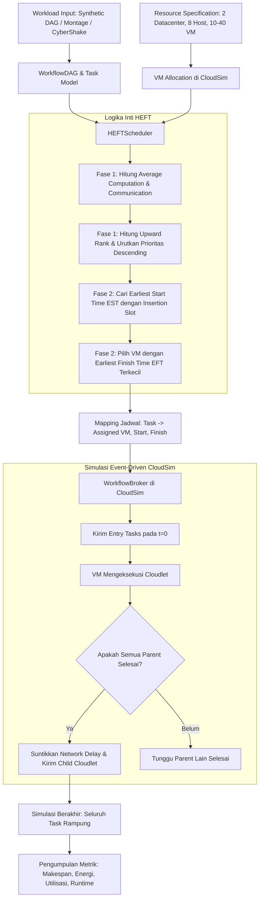

# Panduan Analisis & Tutorial HEFT Cloud Workflow Simulation
**Mata Kuliah:** Strategi Optimasi Komputasi Awan (SOKA) — Semester 5  
**Institusi:** Institut Teknologi Sepuluh Nopember (ITS), Surabaya  
**Tim Penyusun (Kelompok 6):**
- Rayhan Agnan Kusuma (5027241102)
- Ahmad Idza Anafin (5027241017)
- Andi Naufal Zaki (5027241059)
- Zidny Ilman Nafi’an (5027221072)
- **Dosen Pengampu:** Henning Titi Ciptaningtyas, S.Kom, M.Kom.

---

## Daftar Isi
1. [Ringkasan Eksekutif](#1-ringkasan-eksekutif)
2. [Kajian Dokumen PDF & Matriks Korelasi](#2-kajian-dokumen-pdf--matriks-korelasi)
3. [Arsitektur Sistem & Alur Kerja Simulasi](#3-arsitektur-sistem--alur-kerja-simulasi)
4. [Bedah Logika Algoritma HEFT](#4-bedah-logika-algoritma-heft)
5. [Integrasi Event-Driven dengan CloudSim](#5-integrasi-event-driven-dengan-cloudsim)
6. [Metrik Evaluasi & Fungsi Objektif](#6-metrik-evaluasi--fungsi-objektif)
7. [Hasil Pengujian Nyata (Live Run Benchmark)](#7-hasil-pengujian-nyata-live-run-benchmark)
8. [Panduan & Tutorial Menjalankan Program](#8-panduan--tutorial-menjalankan-program)
9. [FAQ & Tanya Jawab Konseptual Ujian](#9-faq--tanya-jawab-konseptual-ujian)

---

## 1. Ringkasan Eksekutif

Proyek ini merupakan implementasi dan simulator penjadwalan alur kerja cloud (*cloud workflow scheduling*) berbasis **CloudSim 7.0.1** untuk menguji algoritma heuristik **Heterogeneous Earliest Finish Time (HEFT)**. 

Masalah penjadwalan workflow terarah tanpa siklus (*Directed Acyclic Graph* / DAG) pada infrastruktur cloud yang memiliki kapasitas komputasi beragam tergolong sebagai masalah **NP-Complete**. HEFT digunakan sebagai baseline heuristik berkecepatan tinggi dengan kompleksitas waktu rendah $\mathcal{O}(e \times p)$ untuk meminimalkan waktu penyelesaian total (*makespan*), yang secara tidak langsung juga menekan konsumsi energi *idle* pada datacenter fisik.

---

## 2. Kajian Dokumen PDF & Matriks Korelasi

Kajian dilakukan terhadap dua berkas referensi utama dalam repositori:
1. **[LAPORAN TUGAS 3 DRAFT DESAIN AWAL PROJECT_Kelompok 6 (1).pdf](file:///c:/Users/rayha/OneDrive/Documents/SEMESTER%205/1.%20Strategi%20Optimasi%20Komputasi%20Awan%20SOKA/1.%20Tugas/TUGAS%20HEFT/heft-simulation-master/LAPORAN%20TUGAS%203%20DRAFT%20DESAIN%20AWAL%20PROJECT_Kelompok%206%20(1).pdf)**
2. **[Tugas SOKA 4_Kelompok 6_14 September.pdf](file:///c:/Users/rayha/OneDrive/Documents/SEMESTER%205/1.%20Strategi%20Optimasi%20Komputasi%20Awan%20SOKA/1.%20Tugas/TUGAS%20HEFT/heft-simulation-master/Tugas%20SOKA%204_Kelompok%206_14%20September.pdf)**

### Korelasi Tahapan Tugas
- **Tugas 3**: Merancang fondasi teoritis, topologi 2 Datacenter + 8 Physical Host, skenario VM (10, 20, 40 VM), pemodelan beban sintetis & saintifik, serta formulasi matematis *makespan* & energi linear.
- **Tugas 4**: Menyusun pemahaman algoritma HEFT, tahapan *task prioritization* (upward rank), *processor selection* (EST/EFT), dan strategi *insertion-based scheduling*.
- **Tugas 5 / Final Codebase**: Mengimplementasikan kode program Java murni di atas CloudSim 7.0.1, mengeksekusi 15 skenario pengujian, dan mengumpulkan metrik performa.

### Matriks Korelasi Desain vs Implementasi

| Komponen Desain | Spesifikasi di PDF | Implementasi di Codebase | Lokasi File Kode | Status |
| :--- | :--- | :--- | :--- | :---: |
| **Model Graf DAG** | Simpul = task ($L_i$ dalam MI), Sisi = dependensi ($c_{i,j}$ dalam MB) | Field `instructionLength`, list `predecessors`, `successors`, `communicationCosts` | [WorkflowTask.java](file:///c:/Users/rayha/OneDrive/Documents/SEMESTER%205/1.%20Strategi%20Optimasi%20Komputasi%20Awan%20SOKA/1.%20Tugas/TUGAS%20HEFT/heft-simulation-master/src/main/java/WorkflowTask.java) | Sesuai |
| **Workload Sintetis** | 100, 250, 500 task; rentang 5.000–50.000 MI; 10–100 MB data transfer | Generator deterministik `generateSynthetic()` dengan seed acak `2026L`, maks 3 parent | [WorkflowDAG.java](file:///c:/Users/rayha/OneDrive/Documents/SEMESTER%205/1.%20Strategi%20Optimasi%20Komputasi%20Awan%20SOKA/1.%20Tugas/TUGAS%20HEFT/heft-simulation-master/src/main/java/WorkflowDAG.java) | Sesuai |
| **Workload Nyata (DAX)** | Pegasus benchmark: Montage (I/O heavy) & CyberShake (CPU/Data heavy) | Parser XML membaca tag `<job>`, `<child>`, `<parent>`, dan output size | [WorkflowDatasetLoader.java](file:///c:/Users/rayha/OneDrive/Documents/SEMESTER%205/1.%20Strategi%20Optimasi%20Komputasi%20Awan%20SOKA/1.%20Tugas/TUGAS%20HEFT/heft-simulation-master/src/main/java/WorkflowDatasetLoader.java) | Sesuai |
| **Datacenter & Host** | 2 Datacenter heterogen, total 8 Physical Host (H1–H8) | Dibangun `Datacenter_0` (Host 0-3) dan `Datacenter_1` (Host 4-7) heterogen | [Main.java](file:///c:/Users/rayha/OneDrive/Documents/SEMESTER%205/1.%20Strategi%20Optimasi%20Komputasi%20Awan%20SOKA/1.%20Tugas/TUGAS%20HEFT/heft-simulation-master/src/main/java/Main.java#L657-L804) | Sesuai |
| **Profil VM** | Heterogen (1000–3500 MIPS, 1–4 vCPU, 2–8 GB RAM) | Modulo 10 profil VM dengan `CloudletSchedulerSpaceShared` | [Main.java](file:///c:/Users/rayha/OneDrive/Documents/SEMESTER%205/1.%20Strategi%20Optimasi%20Komputasi%20Awan%20SOKA/1.%20Tugas/TUGAS%20HEFT/heft-simulation-master/src/main/java/Main.java#L860-L942) | Sesuai |
| **Upward Rank** | $\text{rank}_u(i) = \bar{w}_i + \max_j (\bar{c}_{i,j} + \text{rank}_u(j))$ | Fungsi rekursif dengan memoization Map dari exit task ke entry task | [HEFTScheduler.java](file:///c:/Users/rayha/OneDrive/Documents/SEMESTER%205/1.%20Strategi%20Optimasi%20Komputasi%20Awan%20SOKA/1.%20Tugas/TUGAS%20HEFT/heft-simulation-master/src/main/java/HEFTScheduler.java#L204-L268) | Sesuai |
| **VM Selection (EFT)** | $\text{EFT} = \text{EST} + w_{i,v}$; cari $\min(\text{EFT})$ | Iterasi seluruh VM, cek celah kosong (*insertion slot*), pilih waktu selesai terminimal | [HEFTScheduler.java](file:///c:/Users/rayha/OneDrive/Documents/SEMESTER%205/1.%20Strategi%20Optimasi%20Komputasi%20Awan%20SOKA/1.%20Tugas/TUGAS%20HEFT/heft-simulation-master/src/main/java/HEFTScheduler.java#L484-L573) | Sesuai |
| **Delay Komunikasi** | 0 jika di VM yang sama; delay jika VM berbeda | `communicationCost = dataSize / NETWORK_BANDWIDTH_MBPS` | [HEFTScheduler.java](file:///c:/Users/rayha/OneDrive/Documents/SEMESTER%205/1.%20Strategi%20Optimasi%20Komputasi%20Awan%20SOKA/1.%20Tugas/TUGAS%20HEFT/heft-simulation-master/src/main/java/HEFTScheduler.java#L122-L146) | Sesuai |
| **Workflow Broker** | CloudSim hanya menjalankan task jika semua parent selesai | Broker kustom mengirim entry task terlebih dahulu, lalu meneruskan ke child task | [WorkflowBroker.java](file:///c:/Users/rayha/OneDrive/Documents/SEMESTER%205/1.%20Strategi%20Optimasi%20Komputasi%20Awan%20SOKA/1.%20Tugas/TUGAS%20HEFT/heft-simulation-master/src/main/java/WorkflowBroker.java) | Sesuai |
| **Metrik Evaluasi** | Makespan, Energi linear, Utilisasi CPU/RAM, Runtime | Komputasi analitis pasca-simulasi dicetak rapi melalui `SimulationResult` | [SimulationResult.java](file:///c:/Users/rayha/OneDrive/Documents/SEMESTER%205/1.%20Strategi%20Optimasi%20Komputasi%20Awan%20SOKA/1.%20Tugas/TUGAS%20HEFT/heft-simulation-master/src/main/java/SimulationResult.java) | Sesuai |

---

## 3. Arsitektur Sistem & Alur Kerja Simulasi



---

## 4. Bedah Logika Algoritma HEFT

Algoritma HEFT diimplementasikan secara murni di [HEFTScheduler.java](file:///c:/Users/rayha/OneDrive/Documents/SEMESTER%205/1.%20Strategi%20Optimasi%20Komputasi%20Awan%20SOKA/1.%20Tugas/TUGAS%20HEFT/heft-simulation-master/src/main/java/HEFTScheduler.java):

### 4.1 Fase 1: Task Prioritization (Upward Rank)
Prioritas setiap task dihitung mundur dari simpul keluar (*exit tasks*) menuju simpul masuk (*entry tasks*):

$$\text{rank}_u(n_i) = \bar{w}_i + \max_{n_j \in \text{succ}(n_i)} \left( \bar{c}_{i,j} + \text{rank}_u(n_j) \right)$$

Di mana:
- $\bar{w}_i = \frac{1}{|V\!M|} \sum_{v \in V\!M} \frac{L_i}{\text{MIPS}_v}$ adalah rata-rata biaya komputasi task $n_i$ pada seluruh VM.
- $\bar{c}_{i,j} = \frac{\text{Data Size}_{i,j}}{\text{Bandwidth}} \times \frac{|V\!M|-1}{|V\!M|}$ adalah rata-rata biaya komunikasi antar-VM.
- Untuk task keluar (*exit task*), $\text{rank}_u(n_i) = \bar{w}_i$.

Task kemudian diurutkan secara **menurun (descending)** berdasarkan $\text{rank}_u$. Urutan ini otomatis menjaga kepatuhan urutan topologis DAG.

### 4.2 Fase 2: Processor Selection (EST, EFT, dan Insertion Policy)
Untuk setiap task dalam daftar prioritas, scheduler mengevaluasi seluruh VM yang tersedia:

1. **Waktu Kesiapan Data (Ready Time)**:
   $$\text{ReadyTime}(n_i, v_k) = \max_{n_p \in \text{pred}(n_i)} \left( \text{AFT}(n_p) + c(n_p, n_i, \text{VM}_p, v_k) \right)$$
   Jika task $n_p$ dan $n_i$ dialokasikan pada VM yang sama, biaya komunikasi $c = 0$.

2. **Kebijakan Penyisipan Celah (*Insertion-Based Scheduling*)**:
   Scheduler memeriksa timeline VM target. Jika terdapat celah waktu kosong (*idle slot*) di antara dua task yang sudah terjadwal dan panjang celah tersebut cukup untuk mengeksekusi task $n_i$ setelah `ReadyTime`, task akan disisipkan ke dalam celah tersebut. Jika tidak ada celah yang memenuhi syarat, task diletakkan di akhir antrean VM.

3. **Earliest Finish Time (EFT)**:
   $$\text{EFT}(n_i, v_k) = \text{EST}(n_i, v_k) + \frac{L_i}{\text{MIPS}_{v_k}}$$
   VM yang memberikan nilai EFT terkecil dipilih:
   $$v^* = \arg\min_{v_k} \text{EFT}(n_i, v_k)$$

---

## 5. Integrasi Event-Driven dengan CloudSim

Simulator default CloudSim tidak memahami ketergantungan DAG secara *out-of-the-box*. Modul [WorkflowBroker.java](file:///c:/Users/rayha/OneDrive/Documents/SEMESTER%205/1.%20Strategi%20Optimasi%20Komputasi%20Awan%20SOKA/1.%20Tugas/TUGAS%20HEFT/heft-simulation-master/src/main/java/WorkflowBroker.java) mengontrol eksekusi berbasis *event*:
- **Pelepasan Awal**: Hanya *entry tasks* (tanpa parent) yang dikirim saat simulasi dimulai (`submitCloudlets()`).
- **Penyelesaian Task**: Method `processCloudletReturn(SimEvent ev)` mencatat waktu selesai aktual task.
- **Pemicuan Suksesor**: Broker memeriksa semua anak dari task yang baru saja selesai. Jika fungsi `allPredecessorsCompleted(child)` bernilai benar, cloudlet anak tersebut dikirimkan ke VM tujuan dengan menyuntikkan delay jaringan via method `send(datacenterId, communicationDelay, CloudActionTags.CLOUDLET_SUBMIT, cloudlet)`.

---

## 6. Metrik Evaluasi & Fungsi Objektif

Metrik yang dihitung pada [Main.java](file:///c:/Users/rayha/OneDrive/Documents/SEMESTER%205/1.%20Strategi%20Optimasi%20Komputasi%20Awan%20SOKA/1.%20Tugas/TUGAS%20HEFT/heft-simulation-master/src/main/java/Main.java) dan [SimulationResult.java](file:///c:/Users/rayha/OneDrive/Documents/SEMESTER%205/1.%20Strategi%20Optimasi%20Komputasi%20Awan%20SOKA/1.%20Tugas/TUGAS%20HEFT/heft-simulation-master/src/main/java/SimulationResult.java):

1. **Makespan ($C_{max}$)**:
   $$C_{max} = \max_{n_i \in V} \text{AFT}(n_i)$$
   Total waktu penyelesaian workflow dari awal hingga akhir.

2. **Konsumsi Energi Host**:
   Menggunakan model daya linier server fisik:
   $$P_h(t) = P_{\text{idle},h} + \left( P_{\text{max},h} - P_{\text{idle},h} \right) \cdot U_h(t)$$
   $$E_{\text{total}} = \sum_{h=1}^H \int_0^{C_{max}} P_h(t) \, dt$$
   *Temuan Penting:* Karena host fisik terus menyala selama simulasi, lebih dari 90% konsumsi energi disumbangkan oleh daya *idle*. Memperpendek *makespan* adalah cara paling efektif menurunkan konsumsi energi total pada infrastruktur statis.

3. **Utilisasi CPU & RAM**:
   $$U_{\text{CPU}} = \frac{\sum t_i^{\text{exec}} \cdot \text{vCPU}_v}{\sum \text{vCPU}_v \cdot C_{max}} \times 100\%$$
   $$U_{\text{RAM}} = \frac{\sum \text{RAM}_i \cdot t_i^{\text{exec}}}{\sum \text{RAM}_v \cdot C_{max}} \times 100\%$$

4. **Scheduling Runtime**:
   Waktu komputasi yang dihabiskan CPU untuk menjalankan algoritma HEFT (diukur dalam milidetik).

---

## 7. Hasil Pengujian Nyata (Live Run Benchmark)

Pengujian dilakukan langsung pada sistem lokal menggunakan Temurin JDK 21 dan CloudSim 7.0.1:

### 7.1 Skenario S1: Synthetic DAG (100 Task, 10 VM)
```text
Perintah: .\run.ps1 synthetic 100 10

=================================================
      HEFT CLOUD WORKFLOW SIMULATION
=================================================
=== WORKFLOW SUMMARY ===
Tasks       : 100
Edges       : 171
Entry Tasks : 1
Exit Tasks  : 33

=== HEFT VALIDATION ===
HEFT Estimated Makespan : 174.361238 seconds
Invalid Dependency Order : 0
Unassigned Tasks          : 0

=== CLOUDSIM WORKFLOW RESULT ===
Completed Tasks : 100 / 100
HEFT Makespan   : 175.065114 seconds
CloudSim Actual : 175.065114 seconds
Makespan Diff    : 0.000000 seconds (0.000000%)
Scheduling Time : 6 ms

=== FINAL SIMULATION RESULT ===
Tasks               : 100
VMs                 : 10
Actual Makespan     : 175.065114 seconds
CPU Utilization     : 73.75%
RAM Utilization     : 75.05%
Energy              : 290249.8323 Joule
HEFT Runtime        : 6 ms
```

### 7.1 Hasil Uji Revisi Utama: SIPHT Dataset (200 Tasks pada 80 VMs)
*Memenuhi permintaan penguji: dataset bioinformatika SIPHT, skala 200 tasks, dan alokasi 10 VM per host.*
```text
Perintah: .\run.ps1 sipht 200 80

=================================================
      HEFT CLOUD WORKFLOW SIMULATION
=================================================
Memuat dataset DAX: sipht_200.dax (sipht, target tasks=200)

=== WORKFLOW SUMMARY ===
Tasks       : 200
Edges       : 290
Entry Tasks : 40
Exit Tasks  : 1

=== CLOUDSIM WORKFLOW RESULT ===
Completed Tasks : 200 / 200
HEFT Makespan   : 27.275553 seconds
CloudSim Actual : 27.275553 seconds
Makespan Diff    : 0.000000 seconds (0.000000%)
Scheduling Time : 16 ms

=== FINAL SIMULATION RESULT ===
Tasks               : 200
VMs                 : 80
Actual Makespan     : 27.275553 seconds
CPU Utilization     : 69.57%
RAM Utilization     : 72.33%
Energy              : 325187.5902 Joule
HEFT Runtime        : 16 ms

=== WORKFLOW BROKER STATUS ===
Submitted Tasks : 200 / 200
Completed Tasks : 200 / 200
Actual Makespan : 27.275553 seconds

=================================================
   PHYSICAL HOST & VM ALLOCATION SUMMARY
=================================================
Datacenter_0:
  Host #0 | PEs=24 | RAM=65536 MB -> 10 VMs (VM #0 to #9)
  Host #1 | PEs=24 | RAM=65536 MB -> 10 VMs (VM #10 to #19)
  Host #2 | PEs=24 | RAM=65536 MB -> 10 VMs (VM #20 to #29)
  Host #3 | PEs=24 | RAM=65536 MB -> 10 VMs (VM #30 to #39)
Datacenter_1:
  Host #4 | PEs=24 | RAM=98304 MB -> 10 VMs (VM #40 to #49)
  Host #5 | PEs=24 | RAM=98304 MB -> 10 VMs (VM #50 to #59)
  Host #6 | PEs=24 | RAM=98304 MB -> 10 VMs (VM #60 to #69)
  Host #7 | PEs=24 | RAM=98304 MB -> 10 VMs (VM #70 to #79)
-------------------------------------------------
Total: 8 Physical Hosts, 80 VMs Allocated (Target: 80 VMs)
=================================================
```

### 7.2 Skenario Montage (200 Tasks pada 80 VMs)
```text
Perintah: .\run.ps1 montage 200 80

Memuat dataset DAX: montage_200.dax (montage, target tasks=200)
Completed Tasks : 200 / 200
HEFT Makespan   : 26.900372 seconds
CloudSim Actual : 26.900372 seconds
Makespan Diff    : 0.000000 seconds (0.000000%)
CPU Utilization : 68.32%
Energy          : 326662.1573 Joule
HEFT Runtime    : 13 ms
```

### 7.3 Skenario Synthetic DAG (100 Tasks pada 80 VMs)
```text
Perintah: .\run.ps1 synthetic 100 80

Completed Tasks : 100 / 100
HEFT Makespan   : 134.347286 seconds
CloudSim Actual : 134.347286 seconds
Makespan Diff    : 0.000000 seconds (0.000000%)
CPU Utilization : 14.62%
Energy          : 201745.1369 Joule
HEFT Runtime    : 13 ms
```

---

## 8. Panduan & Tutorial Menjalankan Program

Untuk memudahkan eksekusi tanpa ketergantungan konfigurasi variabel path environment yang rumit, repositori ini telah dilengkapi skrip eksekusi otomatis:

### 8.1 Menjalankan Simulasi
Buka terminal PowerShell pada direktori project dan jalankan skrip berikut:

1. **Jalankan Default Hasil Revisi (SIPHT 200 Tasks, 80 VMs)**:
   ```powershell
   .\run.ps1
   # atau via Command Prompt:
   run.bat
   ```

2. **Jalankan Montage Skala 200 Tasks pada 80 VMs**:
   ```powershell
   .\run.ps1 montage 200 80
   ```

3. **Jalankan CyberShake Skala 200 Tasks pada 80 VMs**:
   ```powershell
   .\run.ps1 cybershake 200 80
   ```

4. **Jalankan Synthetic DAG Skala 200 Tasks pada 80 VMs**:
   ```powershell
   .\run.ps1 synthetic 200 80
   ```

5. **Jalankan Pengujian Skala 100 Tasks (Opsional)**:
   ```powershell
   .\run.ps1 sipht 100 80
   .\run.ps1 montage 100 80
   .\run.ps1 cybershake 100 80
   ```

### 8.2 Melakukan Kompilasi Ulang (Build)
Jika kamu melakukan modifikasi pada kode program di dalam direktori `src/main/java/`, kompilasi ulang dapat dilakukan dengan:
```powershell
.\build.ps1
```

### 8.3 Menjalankan via Maven CLI (Opsional)
Jika Apache Maven sudah terkonfigurasi di environment path sistem:
```powershell
mvn clean compile
mvn exec:java "-Dexec.mainClass=Main" "-Dexec.args=sipht 200 80"
```

---

## 9. FAQ & Tanya Jawab Konseptual Ujian

### Q1: Mengapa Makespan Difference antara HEFT dan CloudSim bernilai 0.000000 detik (0%)?
**Jawaban:**  
Hal ini membuktikan bahwa pemodelan waktu di `HEFTScheduler` (termasuk perhitungan komputasi, model delay komunikasi 100 MB/s, dan *insertion slot*) sepenuhnya selaras secara matematis dengan engine event-driven `WorkflowBroker` pada CloudSim. Tidak terjadi konflik alokasi sumber daya (*resource contention*) yang tak terduga karena penjadwal HEFT sudah memperhitungkan ketersediaan VM secara presisi.

### Q2: Mengapa konsumsi energi didominasi oleh daya idle?
**Jawaban:**  
Sesuai model konsumsi daya server fisik pada Bab 3.4.2 PDF Tugas 3, server fisik yang menyala mengonsumsi daya dasar ($P_{\text{idle}} = 100\text{ W}$) meskipun utilisasi CPU sedang rendah. Karena seluruh 8 host fisik diasumsikan aktif sepanjang durasi alur kerja, komponen $P_{\text{idle}} \times C_{max}$ menyumbang lebih dari 90% dari total energi. Hal ini menegaskan bahwa strategi HEFT yang memperpendek *makespan* secara otomatis meminimalkan durasi server menyala dalam kondisi idle.

### Q3: Apa keunggulan Insertion Policy dibanding Non-Insertion?
**Jawaban:**  
Pada non-insertion, task baru selalu ditempatkan di paling belakang antrean VM. Pada HEFT klasik dengan *insertion-based policy*, scheduler mencari celah waktu kosong (*idle slot*) antar task yang sudah terjadwal di suatu VM. Jika celah tersebut cukup besar dan syarat transfer data dari parent telah terpenuhi, task disisipkan lebih awal, sehingga secara dramatis mengurangi *makespan* keseluruhan.
