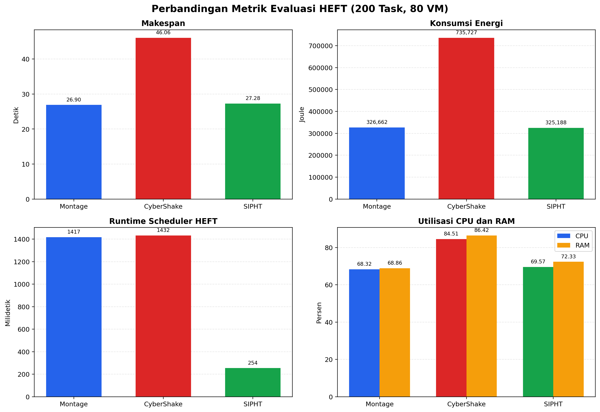

# BAB IV
# HASIL PENGUJIAN DAN EVALUASI

## 4.1 Lingkungan Pengujian

Pengujian dilakukan menggunakan simulator workflow cloud berbasis CloudSim 7.0.1
dengan algoritma Heterogeneous Earliest Finish Time (HEFT). Konfigurasi
infrastruktur dibuat konsisten untuk seluruh workload, yaitu:

| Komponen | Konfigurasi |
|---|---|
| Datacenter | 2 datacenter |
| Physical host | 8 host heterogen |
| Virtual machine | 80 VM heterogen |
| Bandwidth komunikasi HEFT | 100 MB/s |
| Model utilisasi cloudlet | `UtilizationModelFull` |
| Model daya host | 100 W idle dan 250 W maksimum |
| Dataset | CyberShake, Montage, dan SIPHT |
| Ukuran pengujian | 200 task per dataset |

Dataset dijalankan menggunakan berkas DAX yang tersedia di proyek:
`cybershake_200.dax`, `montage_200.dax`, dan `sipht_200.dax`. Berkas tersebut
merupakan dataset contoh/generasi proyek yang mengikuti struktur Pegasus DAX.
Oleh karena itu, hasil pada bab ini merepresentasikan workload yang tersedia di
repository, bukan klaim hasil dari workflow benchmark resmi berskala penuh.

Perintah yang digunakan:

```powershell
.\run.ps1 montage 200 80
.\run.ps1 cybershake 200 80
.\run.ps1 sipht 200 80
```

Apabila `run.ps1` masih menunjuk ke lokasi Java milik komputer pengembang lain,
jalankan setelah kompilasi dengan perintah berikut:

```powershell
mvn clean compile
$cp = "target\classes;$env:USERPROFILE\.m2\repository\org\cloudbus\cloudsim\cloudsim\7.0.1\cloudsim-7.0.1.jar"
java -cp $cp Main montage 200 80
java -cp $cp Main cybershake 200 80
java -cp $cp Main sipht 200 80
```

## 4.2 Metrik Evaluasi

Metrik yang dicatat dari setiap eksekusi adalah:

1. **Jumlah task dan edge**: ukuran DAG dan jumlah dependensi antar-task.
2. **Entry task dan exit task**: jumlah task tanpa predecessor dan tanpa
   successor.
3. **Completion rate**: persentase task yang selesai dieksekusi.
4. **Makespan**: waktu penyelesaian seluruh workflow berdasarkan waktu aktual
   CloudSim.
5. **Makespan difference**: selisih antara makespan hasil penjadwalan HEFT dan
   makespan aktual CloudSim.
6. **CPU utilization**: rasio busy time CPU terhadap kapasitas CPU seluruh VM
   selama makespan.
7. **RAM utilization**: rasio RAM-time task terhadap kapasitas RAM-time seluruh
   VM selama makespan.
8. **Energy consumption**: estimasi energi analitis dalam Joule berdasarkan
   model daya host.
9. **HEFT scheduling runtime**: waktu yang diperlukan scheduler untuk
   menghitung rank, memilih VM, dan membentuk jadwal.
10. **Validasi eksekusi**: jumlah invalid dependency order dan unassigned task.

Rumus metrik utama yang digunakan:

```text
Completion Rate = Completed Tasks / Total Tasks x 100%

CPU Utilization =
    Total Busy CPU Time / Total CPU Capacity Time x 100%

RAM Utilization =
    Total Task RAM-Time / Total RAM Capacity-Time x 100%

Energy = Sum(P_host x execution_time_task)

Energy per Task = Energy / Completed Tasks

Throughput = Completed Tasks / Makespan
```

Nilai `Makespan Difference` yang mendekati nol menunjukkan bahwa jadwal HEFT
dan eksekusi event-driven CloudSim menghasilkan waktu penyelesaian yang
konsisten.

## 4.3 Hasil Pengujian

### 4.3.1 Ringkasan Struktur Workflow

| Dataset | Task | Edge | Entry task | Exit task |
|---|---:|---:|---:|---:|
| Montage | 200 | 250 | 50 | 95 |
| CyberShake | 200 | 190 | 30 | 108 |
| SIPHT | 200 | 263 | 40 | 83 |

Montage memiliki jumlah edge terbesar kedua dan jumlah entry task paling
banyak. CyberShake memiliki jumlah entry task paling sedikit, tetapi exit task
paling banyak. SIPHT memiliki jumlah edge paling banyak, sehingga dependensi
workflow paling rapat di antara ketiga dataset pada konfigurasi ini.

### 4.3.2 Hasil Metrik Utama

Angka desimal pada tabel dinormalisasi menggunakan tanda titik. Semua
pengujian menggunakan 200 task dan 80 VM.

| Dataset | Completed | Completion rate | Makespan (s) | CPU (%) | RAM (%) | Energy (J) | HEFT runtime (ms) |
|---|---:|---:|---:|---:|---:|---:|---:|
| Montage | 200/200 | 100% | 26.900372 | 68.32 | 68.86 | 326,662.1573 | 1,417 |
| CyberShake | 200/200 | 100% | 46.057619 | 84.51 | 86.42 | 735,727.1645 | 1,432 |
| SIPHT | 200/200 | 100% | 27.275553 | 69.57 | 72.33 | 325,187.5902 | 254 |

### 4.3.3 Validasi Konsistensi Jadwal

| Dataset | HEFT makespan (s) | CloudSim actual (s) | Difference (s) | Difference (%) | Invalid dependency | Unassigned task |
|---|---:|---:|---:|---:|---:|---:|
| Montage | 26.900372 | 26.900372 | 0.000000 | 0.000000 | 0 | 0 |
| CyberShake | 46.057619 | 46.057619 | 0.000000 | 0.000000 | 0 | 0 |
| SIPHT | 27.275553 | 27.275553 | 0.000000 | 0.000000 | 0 | 0 |

Ketiga workload menyelesaikan seluruh task. Selisih antara hasil scheduler dan
CloudSim adalah nol pada presisi output yang ditampilkan. Selain itu, tidak ada
pelanggaran urutan dependency dan semua task memperoleh VM.

### 4.3.4 Metrik Turunan

Metrik turunan berikut dihitung dari output pada tabel sebelumnya:

| Dataset | Energy per task (J/task) | Throughput (task/s) | Peringkat makespan |
|---|---:|---:|---:|
| Montage | 1,633.31 | 7.434 | 1 |
| SIPHT | 1,625.94 | 7.333 | 2 |
| CyberShake | 3,678.64 | 4.342 | 3 |

Energy per task dibulatkan dua angka desimal dan throughput dibulatkan tiga
angka desimal.

### 4.3.5 Visualisasi Perbandingan Metrik

Visualisasi dibuat dari data terstruktur pada
[`results/dataset_metrics.csv`](results/dataset_metrics.csv). Dashboard berikut
merangkum makespan, konsumsi energi, runtime scheduler, serta utilisasi CPU dan
RAM:



Grafik individual yang dapat digunakan sebagai gambar terpisah di laporan:

| Metrik | Visualisasi |
|---|---|
| Makespan | [makespan.png](results/figures/makespan.png) |
| Konsumsi energi | [energy.png](results/figures/energy.png) |
| Runtime scheduler HEFT | [heft-runtime.png](results/figures/heft-runtime.png) |
| Utilisasi CPU | [cpu-utilization.png](results/figures/cpu-utilization.png) |
| Utilisasi RAM | [ram-utilization.png](results/figures/ram-utilization.png) |
| Throughput | [throughput.png](results/figures/throughput.png) |

Untuk membuat ulang seluruh grafik setelah mengubah data hasil pengujian:

```powershell
python .\scripts\visualize_metrics.py
```

Script visualisasi hanya menggunakan Python standard library dan
`matplotlib`. Data pada CSV berasal dari eksekusi tiga dataset dengan
konfigurasi 200 task dan 80 VM yang dibahas pada bab ini.

## 4.4 Analisis Hasil

### 4.4.1 Perbandingan Makespan

Montage menghasilkan makespan terendah, yaitu 26.900372 detik. SIPHT memiliki
makespan yang sangat dekat, yaitu 27.275553 detik atau sekitar 1.39% lebih
lama daripada Montage. CyberShake membutuhkan 46.057619 detik, sekitar 71.22%
lebih lama daripada Montage.

Perbedaan tersebut menunjukkan bahwa struktur dependency dan beban komputasi
workflow berpengaruh terhadap panjang critical path. Jumlah task yang sama
tidak menjamin makespan yang sama karena runtime job, struktur DAG, dan
penempatan task pada VM berbeda.

### 4.4.2 Perbandingan Utilisasi Resource

CyberShake memiliki CPU utilization 84.51% dan RAM utilization 86.42%, paling
tinggi di antara ketiga workload. Hal tersebut sejalan dengan makespan dan
energy consumption CyberShake yang juga paling besar. Montage dan SIPHT
memiliki utilisasi CPU yang relatif berdekatan, tetapi SIPHT menggunakan RAM
lebih tinggi daripada Montage.

Utilisasi pada tabel merupakan utilisasi agregat berbasis jadwal task, bukan
pengukuran monitoring perangkat keras fisik. Nilai ini digunakan untuk
membandingkan perilaku workload secara konsisten di dalam simulator.

### 4.4.3 Perbandingan Konsumsi Energi

CyberShake mengonsumsi energi paling besar, yaitu 735,727.1645 Joule. Nilai
tersebut lebih tinggi karena waktu penyelesaian dan busy time workload juga
lebih besar. Montage dan SIPHT menghasilkan konsumsi energi yang hampir sama,
masing-masing 326,662.1573 Joule dan 325,187.5902 Joule.

Energi pada implementasi ini adalah estimasi analitis menggunakan daya
host maksimum ketika task berjalan. Nilai tersebut tidak boleh ditafsirkan
sebagai pembacaan energi listrik aktual dari mesin fisik.

### 4.4.4 Perbandingan Runtime Scheduler

Runtime HEFT untuk SIPHT adalah 254 ms, jauh lebih rendah daripada Montage
(1,417 ms) dan CyberShake (1,432 ms), walaupun ketiganya memiliki 200 task.
Perbedaan ini merupakan waktu eksekusi pengukuran pada satu run dan dapat
dipengaruhi oleh overhead JVM, garbage collection, dan kondisi komputer.
Runtime scheduler sebaiknya dilaporkan sebagai hasil observasi eksperimen,
bukan sebagai kesimpulan kompleksitas hanya dari satu pengukuran.

## 4.5 Kesimpulan Pengujian

Berdasarkan pengujian tiga dataset pada 200 task dan 80 VM:

1. HEFT berhasil menjadwalkan dan menyelesaikan 100% task pada seluruh
   workload.
2. Nilai makespan hasil HEFT sama dengan waktu aktual CloudSim pada output
   pengujian, sehingga integrasi scheduler dan broker berjalan konsisten.
3. Montage memberikan makespan terendah, sedangkan CyberShake menghasilkan
   makespan, utilisasi resource, dan konsumsi energi tertinggi.
4. SIPHT memberikan runtime scheduler terendah dan konsumsi energi per task
   terendah pada pengujian ini.
5. Hasil ini berlaku untuk konfigurasi 200 task, 80 VM, dan berkas DAX yang
   tersedia pada proyek. Pengujian dengan ukuran task/VM berbeda dapat
   menghasilkan urutan performa yang berbeda.

## 4.6 Daftar Screenshot yang Perlu Diambil

Untuk dokumentasi laporan, ambil screenshot terminal yang menampilkan bagian
`CLOUDSIM WORKFLOW RESULT` sampai `FINAL SIMULATION RESULT` dari tiga perintah
berikut:

1. `.\run.ps1 montage 200 80`
2. `.\run.ps1 cybershake 200 80`
3. `.\run.ps1 sipht 200 80`

Pastikan screenshot juga memperlihatkan baris berikut:

- `Memuat dataset DAX`
- `Completed Tasks`
- `HEFT Makespan`
- `CloudSim Actual`
- `Makespan Diff`
- `Scheduling Time`
- `CPU Utilization`
- `RAM Utilization`
- `Energy`
- `HEFT Runtime`

Jika ingin satu screenshot tambahan untuk konfigurasi infrastruktur, ambil
bagian `DATACENTER CONFIGURATION` dan
`PHYSICAL HOST & VM ALLOCATION SUMMARY` dari salah satu run saja, karena
konfigurasinya sama untuk ketiga dataset.
